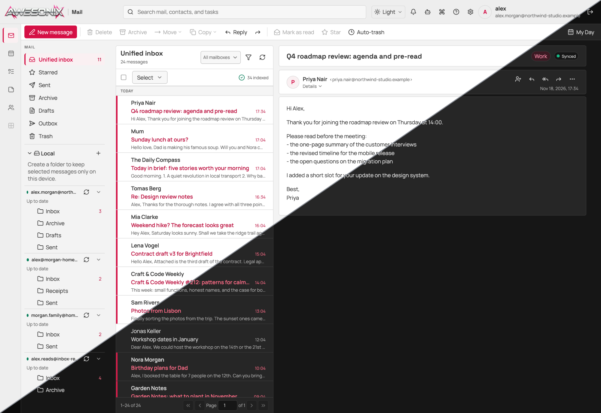

# Awesonix Mail Release

This is the public repository for Awesonix Mail container releases and platform-oriented distribution files. Download the release package from the [GitHub Releases page](https://github.com/awesonix-com/awesonix-mail/releases): the package is this repository at the release tag, and the offline image archive with its `SHA256SUMS` is attached to the release. Inspect `distribution-manifest.json`, verify the archive and `SHA256SUMS` on the [GitHub Release page](https://github.com/awesonix-com/awesonix-mail/releases/tag/v0.115.4), then follow exactly one platform guide:

- `docker/` for Docker Engine or Docker Desktop with Compose.
- `unraid/` for the Unraid Docker template workflow.
- `synology/` for Synology DSM Container Manager projects.
- `truenas/` for prepared Custom App YAML; no TrueNAS release or CPU architecture is qualified yet.

The manuals for this release are in `docs/`. Start with the [installation guide](docs/installation/README.md). It explains the database, the container, and the first-run setup step by step. The [user guide](docs/user-guide/README.md) covers everyday use, and [docs/README.md](docs/README.md) lists every manual.

The database settings are optional in every template. If you leave the database host and password empty, the first-run wizard asks for them in its first step, and the schema build shows its progress. The saved settings are in `database.json` in the secrets folder: back it up with `master.key`. Set the stop grace period to at least 120 seconds, as the templates do.

Read [CHANGELOG.md](CHANGELOG.md) before every upgrade. It lists each version with its upgrade steps, commands, and changes for administrators.

All variants run the same all-in-one image and expose the web application on host port 8180. The token-gated diagnostics listener is `off` by default in every variant, and no variant publishes TCP port 8182. Enable the listener and publish the port only for a diagnostic session on a trusted network. Preserve all database, mail, secrets, and logs storage during upgrades. Backups must live outside those four active storage locations.

The packaged application provides selectable English, Hungarian, German, Dutch, and French interface catalogs with English fallback. The first-round manuals remain English. Consult the package's source-state notice before treating any catalog or image as release-qualified.

The platform templates track `ghcr.io/awesonix-com/awesonix-mail:latest`; the versioned image archive on the [GitHub Release page](https://github.com/awesonix-com/awesonix-mail/releases/tag/v0.115.4) remains available for offline installation. Verify an offline archive and follow the platform guide to tag it for the rolling template reference before installation.

The generated repository's `distribution-manifest.json` is authoritative for the released archive version, build, source revision, source state, image digest, size, and checksum. A redistributable may intentionally remain on an older qualified version while newer source is under review; never rename or relabel its archive to match the development tree.

Do not hand-edit generated platform files or manuals. Their canonical templates and synchronisation tooling live in the Awesonix Mail development repository.

## Licence

The files in this repository (the platform templates, the compose files and the documentation) are under the MIT licence. Read it in [LICENSE](LICENSE). The files in the folder licenses/ keep the licences that they state.

The Awesonix Mail software and its container image are not under the MIT licence. They are under the Awesonix Mail License Agreement. Read it in [licenses/AWESONIX-MAIL-LICENSE-AGREEMENT.md](licenses/AWESONIX-MAIL-LICENSE-AGREEMENT.md).
