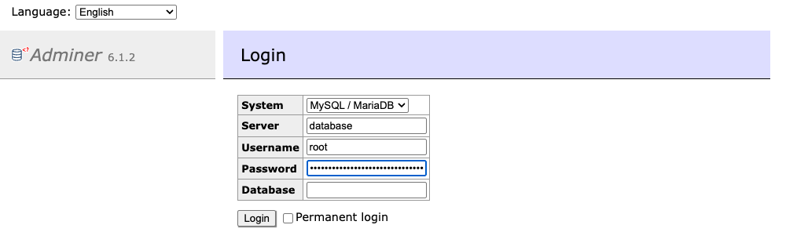
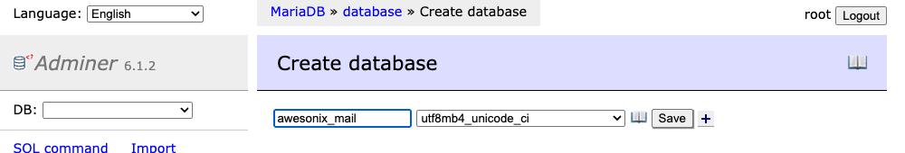
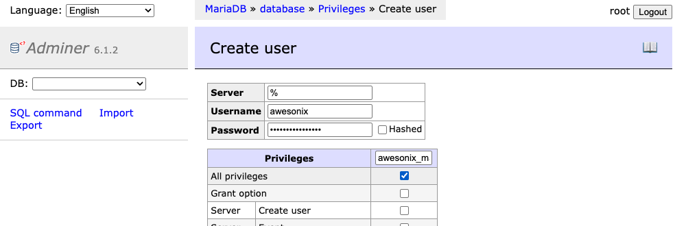

# Step 2: Create the database

Awesonix Mail stores its data in a database on a database server that you run. The Awesonix Mail container never contains or starts a database server. In this step, you make sure that a database server and a user for Awesonix Mail are ready.

Awesonix Mail is tested with MariaDB 11.4. Use a database server of that version or newer. The setup wizard shows a warning for an older version and for any other engine.

## What you need

- A database server that the Awesonix Mail container can reach over the network.
- A user on that server with full rights on one database. The wizard asks for the host, the port, the database name, this user, and its password.
- The database itself is optional. If it is missing, the wizard creates it. If the user may not create it, the wizard shows the exact statement for a database administrator, and you select **Check again** afterwards.

You do not enter the administrator account of the database server in the wizard.

You can enter the database settings in the setup wizard (step 4). You can also set them in the container settings; see [Optional: set the database in the deployment](#optional-set-the-database-in-the-deployment).

Follow the section for your platform:

- [Unraid](#unraid)
- [Synology and Docker](#synology-and-docker)
- [You already have a database server](#you-already-have-a-database-server)

## Unraid

You install MariaDB as a separate container from the Unraid **Apps** tab.

> **Warning:** Put the database files on an SSD pool, not on the array. On the array, the database is slow, and Awesonix Mail can become slow too.

1. Open the Unraid web interface and go to the **Apps** tab.
2. Search for `MariaDB`. Select the **mariadb** app from **linuxserver**.
3. Select **Install**. The container settings page opens.
4. Fill in these fields:

   | Field | Value |
   |---|---|
   | `MYSQL_ROOT_PASSWORD` | your database root password |
   | `MYSQL_DATABASE` | `awesonix_mail` |
   | `MYSQL_USER` | `awesonix` |
   | `MYSQL_PASSWORD` | your database user password |
   | **Appdata** | a path on your SSD pool, for example `/mnt/cache/appdata/mariadb` |

5. Keep the port at `3306`.
6. Select **Apply**. Unraid downloads and starts the container.
7. Wait one minute. Then open the **Docker** tab, select the MariaDB icon, and select **Logs**.

**What you should see:** The log ends with a line that contains `ready for connections`.

The database name, user, and password are now ready. Awesonix Mail creates its own tables when it first connects to the database.

### Recommended database settings on Unraid

These settings make the database faster. They are optional for a small installation.

1. Stop the MariaDB container.
2. Open the file `custom.cnf` in the MariaDB appdata folder, for example with the Unraid file manager.
3. In the `[mysqld]` section, set these values:

   ```ini
   innodb_buffer_pool_size = 1G
   tmp_table_size          = 64M
   max_heap_table_size     = 64M
   ```

4. Save the file and start the container again.

Use a buffer pool that is larger than your database. `1G` is enough for a database of a few hundred megabytes.

> **Warning:** MariaDB ignores a configuration file that everyone can write to. If your changes have no effect, set the file permission to `644`.

## Synology and Docker

On Synology and with Docker, you install MariaDB in the same project as Awesonix Mail. You do this in step 3.

Write down a database root password and a database user password now. Then continue with [Step 3: Install Awesonix Mail](3-install.md).

## You already have a database server

If a database server already runs on your network, create a user for Awesonix Mail. You can also create an empty database. If you skip the database, the setup wizard creates it when the user may do so.

You can do this with a web tool or with commands.

### With the Adminer web tool

Adminer is a small web page for MariaDB. Start it as a container, for example with this command:

```sh
docker run -d --name adminer -p 8188:8080 adminer:6.1.2
```

1. Open Adminer at port `8188` of the computer that runs it, for example `http://192.168.1.10:8188`.
2. In **System**, keep **MySQL / MariaDB**. In **Server**, enter the address of your MariaDB server.
3. Enter the **Username** `root` and the root password of MariaDB. Select **Login**.

   <!-- shot:db-01 -->
   

4. Select **Create database**. Enter the name `awesonix_mail`, select the collation `utf8mb4_unicode_ci`, and select **Save**.

   <!-- shot:db-02 -->
   

5. Select **Privileges** and then **Create user**.
6. In **Server**, keep `%`. In **Username**, enter `awesonix`. In **Password**, enter your database user password.
7. In the field at the top of the **Privileges** column, enter `awesonix_mail.*`. Then select **All privileges** and select **Save**.

   <!-- shot:db-03 -->
   

When you are done, stop and delete the Adminer container:

```sh
docker rm -f adminer
```

### With commands

1. Connect to MariaDB as an administrator, for example with the `mariadb` command.
2. Run these commands. Replace `your-password` with your database user password.

   ```sql
   CREATE DATABASE awesonix_mail CHARACTER SET utf8mb4 COLLATE utf8mb4_unicode_ci;
   CREATE USER 'awesonix'@'%' IDENTIFIED BY 'your-password';
   GRANT ALL PRIVILEGES ON awesonix_mail.* TO 'awesonix'@'%';
   FLUSH PRIVILEGES;
   ```

3. Make sure that Awesonix Mail can reach port `3306` of the MariaDB server.

The user needs full rights only on the `awesonix_mail` database. It does not need rights on other databases.

The `CREATE DATABASE` line is optional. If you leave it out, the setup wizard creates the database, or it shows the statement for you to run. The wizard shows the statement without the password. Its host part is `%`. You can narrow it to the address of the Awesonix Mail container.

Check these server settings:

- Keep `innodb_autoinc_lock_mode` at `1`. This is the MariaDB default. The phone app needs it to receive every change.
- Store the database files on an SSD.
- Use a buffer pool that is larger than the Awesonix Mail database, for example `innodb_buffer_pool_size = 1G`.

## Optional: set the database in the deployment

The container settings have these variables: `AWESONIX_MAIL_DATABASE_HOST`, `AWESONIX_MAIL_DATABASE_PORT`, `AWESONIX_MAIL_DATABASE_NAME`, `AWESONIX_MAIL_DATABASE_USER`, and `AWESONIX_MAIL_DATABASE_PASSWORD`.

All of them are optional. If you leave the host and the password empty, the setup wizard asks for the database settings on the first start. An empty value counts as not set.

If you set the host and the password, the variables always win. The wizard then shows the database step read-only, and Awesonix Mail builds the database at the start. Do not set only one of them. The wizard then stops and names the missing variable.

To change a password that you rotated later, change the variables in the container settings. See [Troubleshooting](../troubleshooting/README.md) if the database stops working.

## If it does not work

- **The MariaDB log shows an error about a password:** Delete the container and its appdata folder, and install it again. MariaDB reads the passwords only on the first start.
- **The MariaDB container stops right after it starts:** Make sure that the appdata path exists and that the disk has free space.

## Next step

Continue with [Step 3: Install Awesonix Mail](3-install.md).
