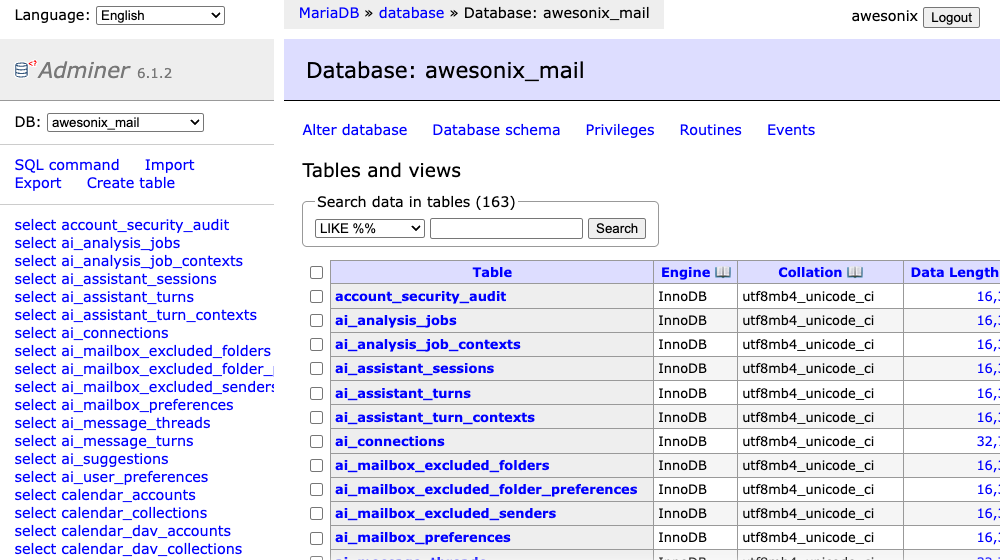

# Step 3: Install Awesonix Mail

In this step, you install the Awesonix Mail container. The container starts at once. You then enter the database settings in the setup wizard (step 4). You can also set them here, in the container settings.

## Get the release package

Download the release package from the Awesonix Mail release location that the `README.md` in the root of the package names. The package contains these folders:

- `unraid`: the Unraid template
- `synology`: the Synology Container Manager project
- `docker`: the Docker Compose project
- `docs`: this manual

Follow the section for your platform:

- [Unraid](#unraid)
- [Synology](#synology)
- [Docker](#docker)

## Unraid

1. Copy the file `unraid/my-awesonix-mail.xml` to the folder `/boot/config/plugins/dockerMan/templates-user/` on your Unraid server. You can use the `flash` network share or the Unraid file manager.
2. Open the **Docker** tab and select **Add Container**.
3. In **Template**, select **awesonix-mail**.
4. The database fields are optional. Leave **Database Server Address** and **Database Password** empty to enter the database settings in the setup wizard. Or fill in the fields with the values from step 1. Then the variables win, and the wizard shows the database step read-only:

   | Field | Value |
   |---|---|
   | **Database Server Address** | the IP address of your Unraid server, for example `192.168.1.10` |
   | **Database Server Port** | `3306` |
   | **Database Name** | `awesonix_mail` |
   | **Database Username** | `awesonix` |
   | **Database Password** | your database user password |

5. Keep the three storage paths. Awesonix Mail creates these folders by itself.
6. Select **Apply**. Unraid downloads and starts the container.

> **Warning:** Do not enter `127.0.0.1` or `localhost` as the database address, here or in the wizard. Inside a container, these addresses mean the container itself, not your server.

The template sets a stop timeout of 120 seconds. Keep it. A stop then never cuts a database update in the middle.

## Synology

1. In **File Station**, create the folder `/volume1/docker/awesonix-mail`.
2. Copy the file `synology/docker-compose.yml` into this folder.
3. Open the copied `docker-compose.yml` in a text editor. Add the [database service](#the-database-service) below the line `services:`.
4. Create a file with the name `.env` in the same folder, with the [settings file](#the-settings-file) content.
5. Open **Container Manager > Project** and select **Create**.
6. Enter the project name `awesonix-mail`. Select the folder from step 1 as the path. Select the existing `docker-compose.yml` as the source.
7. Select **Next** and then **Done**. Container Manager downloads and starts both containers.

## Docker

1. Create a folder with the name `awesonix-mail`.
2. Copy the file `docker/docker-compose.yml` into this folder.
3. Open the copied `docker-compose.yml` in a text editor. Add the [database service](#the-database-service) below the line `services:`.
4. Create a file with the name `.env` in the same folder, with the [settings file](#the-settings-file) content.
5. On a Mac with Apple silicon or another ARM computer, add the line `platform: linux/amd64` below `container_name: awesonix-mail`. Docker then emulates the amd64 processor.
6. Open a terminal in the folder and run this command:

   ```sh
   docker compose up -d
   ```

## The database service

Awesonix Mail does not contain a database server. On Synology and with Docker, you can add a separate database container to the same project. Skip this section if you already run a database server elsewhere.

Add this block to `docker-compose.yml`, directly below the line `services:`. Keep the spaces at the start of each line. YAML files use spaces to show the structure.

```yaml
  database:
    image: mariadb:11.4
    container_name: awesonix-mail-database
    environment:
      MARIADB_ROOT_PASSWORD: ${MARIADB_ROOT_PASSWORD:?Set the database root password}
      MARIADB_DATABASE: awesonix_mail
      MARIADB_USER: awesonix
      MARIADB_PASSWORD: ${AWESONIX_MAIL_DATABASE_PASSWORD:?Set the database user password}
    volumes:
      - ./data/database:/var/lib/mysql
    healthcheck:
      test: ["CMD", "healthcheck.sh", "--connect", "--innodb_initialized"]
      interval: 10s
      timeout: 5s
      retries: 30
    restart: unless-stopped
```

Then find the `awesonix-mail:` service in the same file. Add these lines below the line `container_name: awesonix-mail`, with the same spaces:

```yaml
    depends_on:
      database:
        condition: service_healthy
```

With these lines, Awesonix Mail starts only after the database is ready.

## The settings file

Put these lines into the `.env` file. Replace the two passwords with your own passwords from step 1.

```ini
AWESONIX_MAIL_DATABASE_HOST=database
AWESONIX_MAIL_DATABASE_PASSWORD=your-database-user-password
MARIADB_ROOT_PASSWORD=your-database-root-password
```

`database` is the name of the database service. The containers in one project find each other by their service names.

With these lines, Awesonix Mail uses the database settings at once. The wizard shows the database step read-only. If you run a database server elsewhere, leave `AWESONIX_MAIL_DATABASE_HOST` and `AWESONIX_MAIL_DATABASE_PASSWORD` out of the file. You then enter the database settings in the wizard.

The compose file sets a stop grace period of 120 seconds. Keep it.

> **Warning:** The `.env` file contains passwords. Do not share it, and do not put it into a public place.

## Optional: a web tool for the database

Adminer is a small web page for MariaDB. With Adminer, you can look into the database without commands. You do not need it for Awesonix Mail, but it helps if you want to check the database.

On Synology and with Docker, add this block below the line `services:` in `docker-compose.yml`:

```yaml
  adminer:
    image: adminer:6.1.2
    container_name: awesonix-mail-adminer
    ports:
      - "8188:8080"
    environment:
      ADMINER_DEFAULT_SERVER: database
    restart: unless-stopped
```

After the start, open Adminer at port `8188` of your server, for example `http://192.168.1.10:8188`. Sign in with the database user name `awesonix` and its password.

> **Warning:** Adminer gives full access to the database. Do not make port `8188` reachable from the internet. Remove the block when you do not need Adminer.

## Check that it works

1. Wait a minute. The first start takes longer because the containers are downloaded.
2. Open the Awesonix Mail web address in your browser, for example `http://192.168.1.10:8180`.

**What you should see:** The setup wizard opens. If the container has no database settings, the first step is **Database**.

The page answers from the first second. On a slow disk, the first database build can take many minutes. The wizard shows the progress. Until the build ends, the container health shows `starting`.

If you added Adminer, you can also check the database. After the first start, the database `awesonix_mail` contains many tables. Awesonix Mail creates them by itself.

<!-- shot:db-04 -->


## If it does not work

- **The page does not open:** Check that the container runs. On Unraid, look at the **Docker** tab. On Synology, look at **Container Manager > Container**. With Docker, run `docker compose ps`.
- **The page shows that it is waiting for the database:** Awesonix Mail cannot reach the database server. It keeps trying. Check the database address, port, and that the server runs. If you set the database in the container settings, correct the values and restart the container.
- **The log or the page shows that the user or password is not accepted:** The database user name or password is wrong. In the wizard, correct the values. If you set them in the container settings, correct them there and restart the container.
- **Anything else about the database:** See [Troubleshooting](../troubleshooting/README.md).

## Next step

Continue with [Step 4: Run the setup wizard](4-setup-wizard.md).
