# Step 4: Run the setup wizard

When Awesonix Mail starts for the first time, it opens a setup wizard. In this step, you connect the database, create the first administrator, and choose the basic settings.

The wizard has six steps. The first step is **Database**. If you set the database in the container settings, this step is read-only.

<!-- shot:setup-00c -->
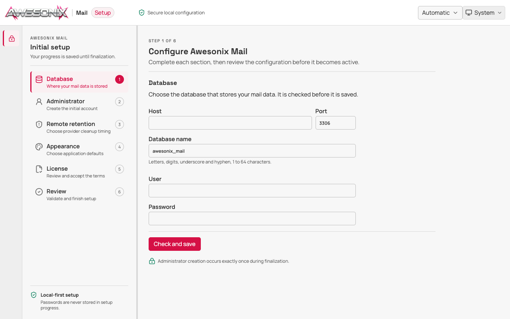

You can leave the wizard and come back later, after the database build has ended. When you come back, enter the passwords again, because the wizard does not save them.

> **Warning:** Finish the wizard soon after the installation. Until you finish it, anyone on your network who opens the web address can run the wizard. This includes the database step. Do not start a fresh installation on a public address.

> **Warning:** Before version 1.0, the browser sends the database password to Awesonix Mail over plain HTTP. Run the wizard on a trusted local network, or behind a reverse proxy that uses HTTPS.

## Open the wizard

Open the Awesonix Mail web address in your browser, for example `http://192.168.1.10:8180/setup`.

## 1. Database

Tell Awesonix Mail where its database is. Use the database server and the user from [step 2](2-database.md).

1. Enter the **Host**, the **Port**, the **Database name** (the default is `awesonix_mail`), the **User**, and the **Password**.
2. Select **Check and save**.

Do not enter the address `127.0.0.1` or `localhost` as the host. Do not enter the administrator account of the database server.

<!-- shot:setup-00 -->
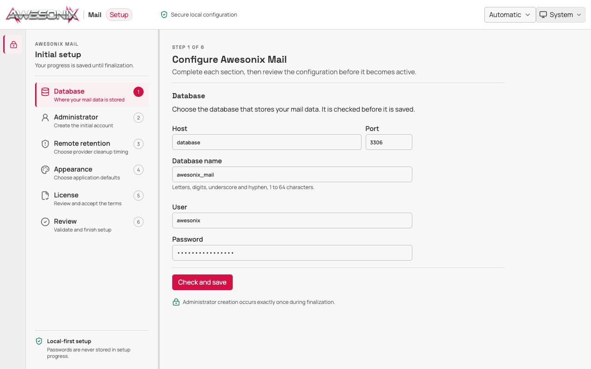

Awesonix Mail checks the connection and the rights of the user. Then one of these results happens:

- **The check passes.** The wizard saves the settings and locks this step. The database build starts in the background, and you can continue with the next step.
- **The database is missing.** The wizard creates it.
- **The user may not create the database.** The wizard shows the exact statement for a database administrator. Ask the administrator to run it. Then select **Check again**. The statement does not contain the password.
- **The database already holds other tables.** The wizard asks you to confirm. Confirm only if you are sure that Awesonix Mail may use this database.
- **A check fails.** The wizard shows what is wrong, for example a wrong password or missing rights. Nothing is saved. Correct the values and select **Check and save** again.

<!-- shot:setup-00b -->
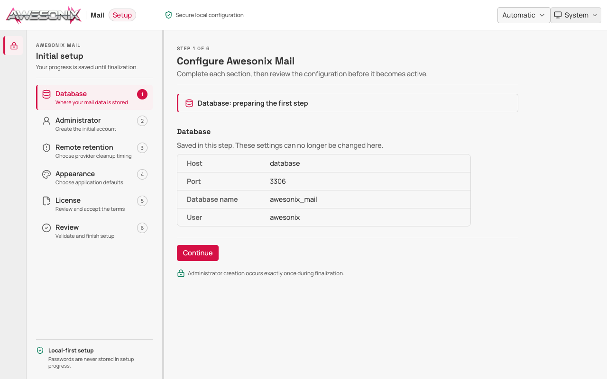

After the first save, you cannot change the database settings in the wizard. A bar at the top shows the progress of the build, for example `Database: step n of m`. A first build on slow storage, for example on spinning disks, can take many minutes.

<!-- shot:setup-00e -->
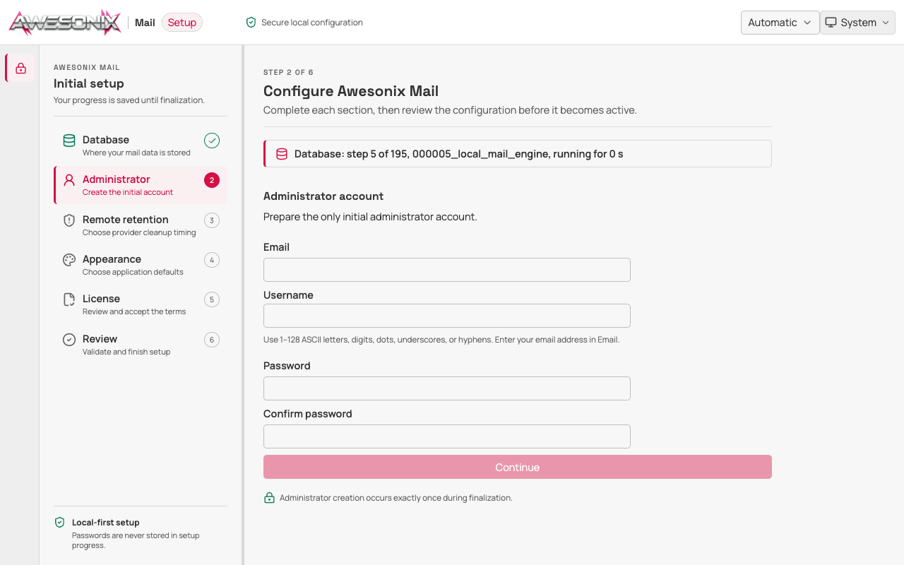

> **Warning:** While the build runs, your answers on the other steps stay only in the browser page. Do not reload the page, and use one browser tab only. A reload loses the answers that you typed. The build itself goes on.

> **Warning:** Do not stop, restart, or update the database server while the build runs. A database update that is interrupted leaves the database in a dirty state. The build then needs the manual repair in the troubleshooting guide, section "A dirty schema". If the database server is not reachable before a step starts or between steps, the build waits and continues by itself.

If the build still runs when you select the last button, a full page shows the progress. Setup then finishes by itself when the build ends.

<!-- shot:setup-00d -->
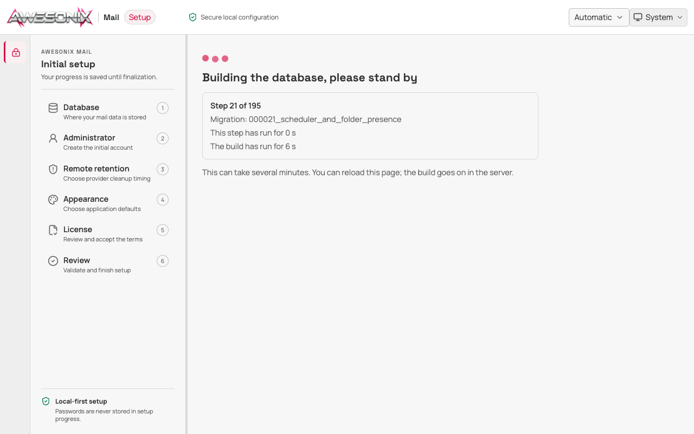

If the build waits for the database or fails, see [Troubleshooting](../troubleshooting/README.md).

## 2. Administrator

Create the account of the first administrator. You use this account to sign in and to manage the installation.

1. Enter an email address, a user name, and a password.
2. Enter the password again in the confirmation field.
3. Select **Continue**.

The user name accepts 1–128 ASCII letters, digits, dots, underscores or hyphens. Spaces and email addresses are invalid; put the email address in its separate field. Correcting the user name keeps the other setup values.

Use a strong password, and keep it in a password manager. This account can manage all users and settings. No other administrator can reset its password.

<!-- shot:setup-01 -->
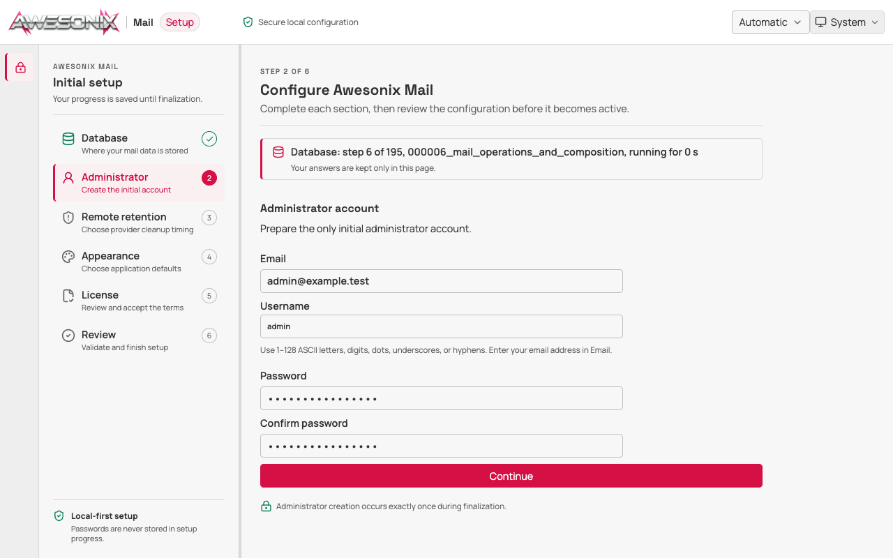

## 3. Remote retention

Choose if Awesonix Mail may clean up old messages on your mail provider, and how much cached mail each user may store.

1. In **Messages older than**, choose **Never** if you are not sure. With **Never**, Awesonix Mail does not move old messages to Bin on your provider.
2. In the storage quota, keep **Unlimited** if you are not sure. You can change it later in **Settings > Administration > Storage**.
3. Select **Continue**.

Local folders are never affected by this cleanup.

<!-- shot:setup-02 -->
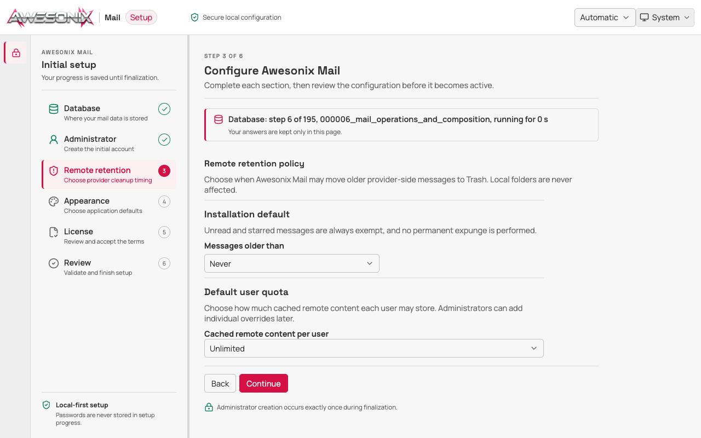

## 4. Appearance

Choose the default look for all users, for example light or dark mode. Each user can change it later in **Settings > General > Appearance**. Select **Continue**.

<!-- shot:setup-03 -->
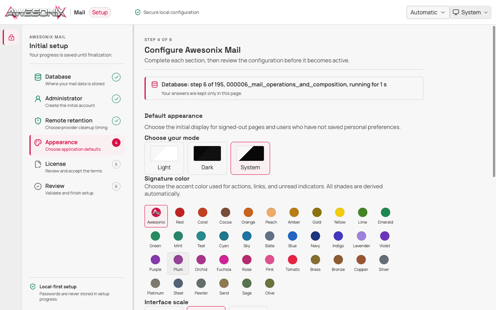

## 5. Licence

Read the licence terms. If you agree, select the check box **I have read and accept** and then select **Continue**.

<!-- shot:setup-04 -->
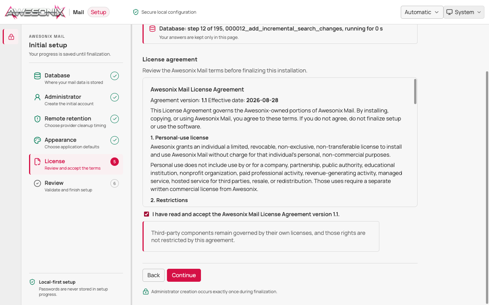

## 6. Review

Check your choices. The database shows as connected. The database settings are locked, and you cannot change them here. Select **Finalise setup** to create the installation.

The page **Awesonix Mail is configured** opens. Select **Continue to sign in**. The wizard is now closed for good, and you cannot run it again.

<!-- shot:setup-05 -->
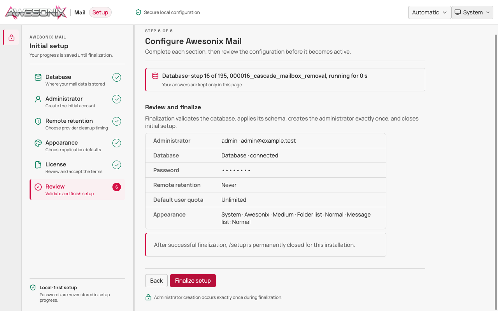

## Sign in

The sign-in page opens. Sign in with the user name or email address and the password of the administrator.

**What you should see:** Awesonix Mail opens with an empty inbox.

<!-- shot:setup-06 -->
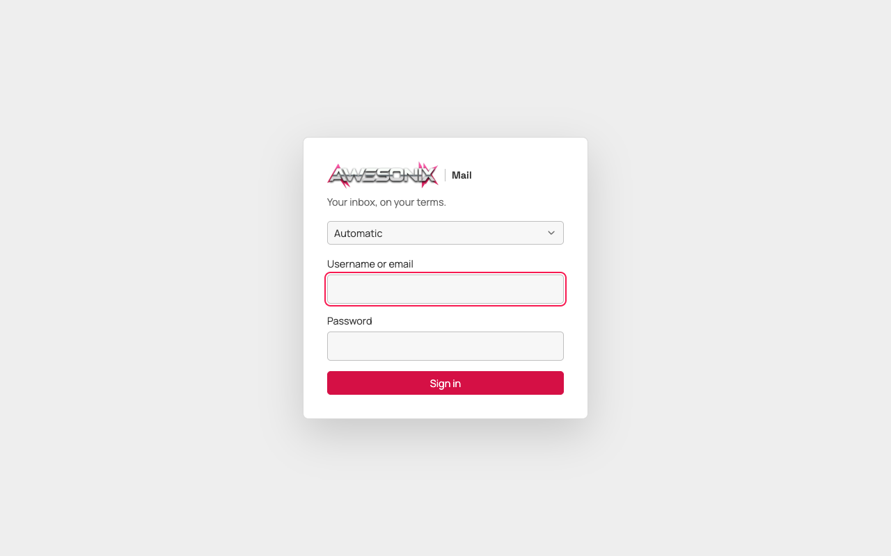

## If it does not work

- **The wizard shows an error when you finalise it:** Check the container log for a database error. Then reload the page and finish the wizard again. Reloading loses your typed answers, so reload only when no build runs.
- **The page shows that the database set-up is waiting, failed, or blocked:** See [Troubleshooting](../troubleshooting/README.md). The container log has the details.
- **You forgot the administrator password:** Run the recovery command on the server. The [administrator guide](../administrator-guide/README.md#recover-the-founding-administrator) explains the steps.

## Next step

Continue with [Step 5: Connect your mailbox](5-mailbox.md).
