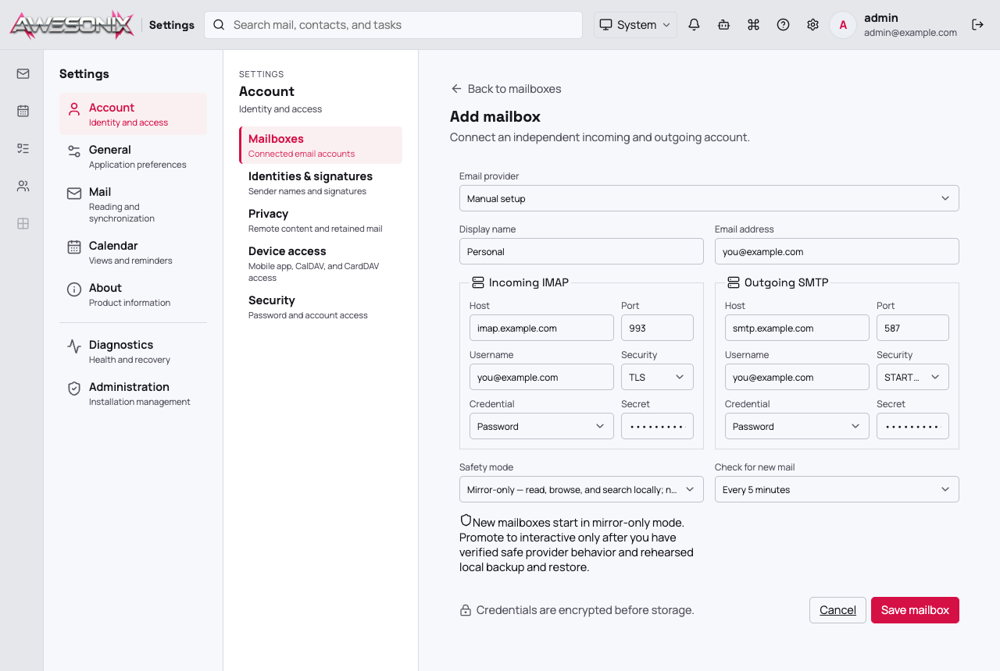

# Step 5: Connect your mailbox

In this step, you connect your first mail account. Awesonix Mail then downloads your mail in the background.

## Before you start

You need these items from your mail provider:

- your email address
- your password, or an app password

Many providers, for example Gmail, Outlook.com, and iCloud, do not accept your normal password from other mail programs. For these providers, create an app password on the website of the provider. The provider list in Awesonix Mail tells you if your provider needs one.

## Add the mailbox

1. Sign in to Awesonix Mail.
2. Open **Settings > Account > Mailboxes**.
3. Select **Add mailbox**.
4. In **Email provider**, select your provider. Awesonix Mail fills in the server addresses and ports for you.
5. If your provider is not in the list, keep **Manual setup**. Then enter the **Host** and **Port** of the **Incoming IMAP** and **Outgoing SMTP** servers. Your provider's help pages list them.
6. Enter a **Display name** and your **Email address**.
7. In both server boxes, enter your **Username** and, in **Secret**, your password or app password.
8. Keep **Safety mode** at **Mirror-only** for now.
9. Select **Save mailbox**.

<!-- shot:mailbox-01 -->

**What you should see:** The mailbox shows in the list. Its folders appear in the folder list on the left. The newest messages arrive first. A large mailbox can take several hours to download completely.

## Mirror-only and interactive

A new mailbox starts in **Mirror-only** mode. In this mode, Awesonix Mail only reads your mail. It does not change anything on your mail provider, and you cannot send mail from this mailbox.

When you are sure that everything works, change the mailbox to **Interactive**. Then you can send, move, and delete mail.

1. Open **Settings > Account > Mailboxes**.
2. Select **Modify** for the mailbox.
3. In **Safety mode**, select **Interactive**.
4. Read the warning and confirm it.

> **Warning:** In interactive mode, a delete or move in Awesonix Mail also changes the mail on your provider.

You can change an interactive mailbox back to **Mirror-only** in the same place. From then on, Awesonix Mail starts no new change on your provider. A change that has already started, such as a message being sent, finishes. Changes that have not started yet wait as blocked, and they continue when you make the mailbox interactive again.

## If it does not work

- **The mailbox shows an authentication error:** Check the password. If your provider needs an app password, create one and enter it instead of your normal password.
- **The mailbox shows a connection error:** Check the server addresses and ports in **Manual setup**. Your provider's help pages list the correct values.
- **No messages arrive after 10 minutes:** Open **Settings > Administration > Mailboxes** and check the state of the mailbox.

## Next step

Continue with [Step 6: Connect your phone](6-phone.md).
