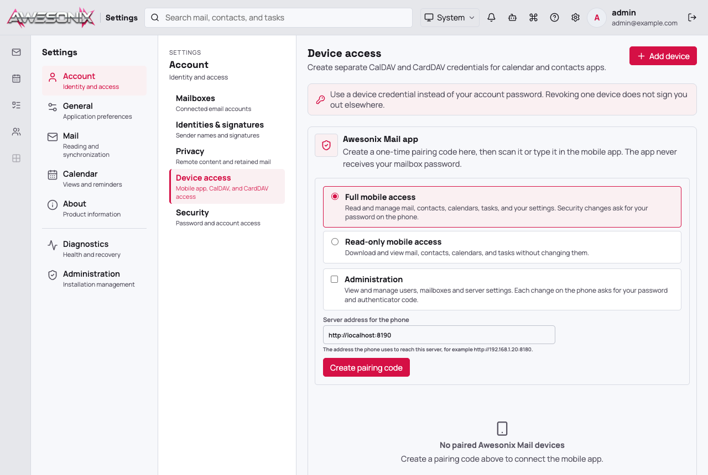

# Step 6: Connect your phone

The Awesonix Mail app for Android and iOS shows your mail, calendar, contacts, tasks, and notes. It also works offline. In this step, you pair the app with your server. This step is optional.

> **Recommended:** Use a domain name with HTTPS, for example `https://mail.example.com`, as the server address for the phone. With an IP address, the app works only in your home network, and you must pair it again if the address changes. From version 1.0, the app requires HTTPS. [Step 7](7-secure.md) shows how to set it up.

## Pair the app

You create a pairing code in the browser. Then you scan or type the code in the app.

1. On a computer, sign in to Awesonix Mail in the browser.
2. Open **Settings > Account > Device access**.
3. Select **Full mobile access** or **Read-only mobile access**.
4. Check the **Server address for the phone**. The phone uses this address to reach your server, for example `http://192.168.1.10:8180` or your HTTPS address.
5. Select **Create pairing code**. A code and a QR code appear.
6. Install the Awesonix Mail app that you got from your administrator, and open it.
7. Scan the QR code with the app, or type the code.

**What you should see:** The app opens your mailbox. Your mail, calendar, contacts, tasks, and notes appear after a short time.

<!-- shot:phone-01 -->

Use the HTTPS address from [step 7](7-secure.md) if you have one. Before version 1.0, the app also accepts an `http` address with an IP address on your own network.

## Choose the access level

| Access level | What the app can do |
|---|---|
| **Full mobile access** | Read, write, send, move, and delete mail. Change contacts, calendars, tasks, and notes. |
| **Read-only mobile access** | Read everything, including notes. The app hides all buttons that change data. |

Notes uses the same two access levels. Read-only access reads notes, and full access also creates and edits them. A phone that was paired before Notes existed gets Notes with its current access. You do not need to pair it again or approve anything new. Private notes open on the phone with your notes PIN while the phone is online.

The phone never receives the password of your mail provider. It gets its own key, and you can take it back at any time.

> **Warning:** Use a pairing code only on your own phone. Anyone with the code can pair a device to your account while the code is valid.

## If you lose your phone

1. Sign in to Awesonix Mail in the browser.
2. Open **Settings > Account > Device access**.
3. Remove the lost device.

The app deletes its local data the next time that it connects to the server.

## If it does not work

- **The app cannot reach the server:** Make sure that the phone is on the same network as the server, or use your HTTPS address.
- **The app does not accept the code:** A pairing code is valid only for a short time and only once. Create a new code in the browser.

## Next step

Continue with [Step 7: Make it safe](7-secure.md).
